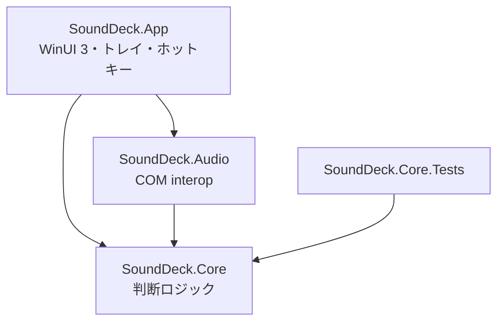

# SoundDeck 技術選定と全体アーキテクチャ

[[README|SoundDeck]] を作るときに決めたことと、その理由のメモ。実装中にぶつかった落とし穴も残しておく。

## 技術選定

| 領域 | 採用 | 理由 |
| --- | --- | --- |
| UI | WinUI 3（Windows App SDK 2.x、unpackaged、自己完結） | Mica・アクリル・Fluent のコントロールが標準で揃い、Windows 11 の見た目に一番近い。MSIX にしないので配布は ZIP で済む |
| Windows App SDK の参照 | `Microsoft.WindowsAppSDK.WinUI` と `InteractiveExperiences` だけ | メタパッケージだと ONNX Runtime や DirectML まで同梱され、発行物が 230 MB になる。部品指定で 170 MB（ZIP 65 MB）に減った |
| MVVM | CommunityToolkit.Mvvm 8.4（部分プロパティ） | `[ObservableProperty]` の部分プロパティ形式なら WinUI の AOT 系警告も出ない |
| 音声 | 自前の COM interop | NAudio は 3.x で API が変わったばかり。非公開 API はどのみち自前で書くので、全部そろえた |
| トレイアイコン | 自前（`Shell_NotifyIcon`） | H.NotifyIcon は WinAppSDK 1.6 向けで 2.x との相性が読めない。ホットキー用の隠しウィンドウも要るので、同じウィンドウで受ける |
| トレイの絵 | Segoe Fluent Icons の文字を GDI で HICON に描く | Windows 11 の標準の音量アイコンと同じ形になる。タスクバーのテーマに合わせて白・黒を切り替える |
| 設定画面 | XAML を持たないコードだけのページ | ページが 8 枚あり、カードを並べるだけなので、C# で組み立てた方が短い |

## 層の分け方

- **Core** は OS に触らない。プロファイルの差分計算（`ProfilePlanner`）、ルールの一致判定（`RuleEngine`）、ダッキングの状態（`DuckingController`）、音量記憶（`VolumeMemoryService`）、設定の保存（`SettingsStore`）。どれも「今の状態を渡すと、やるべきことを返す」形にして、テストで時刻を進められるよう `TimeProvider` を受け取る
- **Audio** は Core Audio の薄いラッパー。`AudioDeviceManager` → `AudioDevice` → `AudioSessionCollection` → `AudioSession`。非公開 API は `DefaultDeviceSwitcher` と `AppRouting`
- **App** の `AudioService` が中心で、OS からの通知を UI スレッドに戻してから ViewModel に反映し、Core の判断結果を実行する

## 非公開 API

| 用途 | API | 備考 |
| --- | --- | --- |
| 既定デバイスの切り替え | `IPolicyConfig`（CLSID `870AF99C-…`） | Console・Multimedia・（任意で）Communications の 3 役割に設定する |
| アプリ別の出力先 | `Windows.Media.Internal.AudioPolicyConfig` のファクトリ（IID `ab3d4648-…`） | IInspectable 派生なので、vtable の 25 番目（Set）と 26 番目（Get）を関数ポインタで直接呼ぶ。デバイス ID は `\\?\SWD#MMDEVAPI#{id}#{インターフェース GUID}` の形にして渡す |

どちらも失敗したら例外を握って OSD とログに出し、その操作だけ諦める。

## 落とし穴

> [!bug] STA で取得した COM オブジェクトは MTA に持ち出せない
> UI スレッド（STA）で `IMMDeviceEnumerator.GetDevice` を呼び、返ってきた `IMMDevice` を MTA のスレッドで使うと `E_NOINTERFACE` で落ちた。逆に **MTA で取得したオブジェクトは UI スレッドから普通に呼べる**。セッション通知の登録は MTA でないと通知が届かない仕様でもあるので、COM オブジェクトを取得する処理（デバイスを開く、セッション一覧を取る）は必ず `ComHelpers.RunInMta` を通す。コンソールでの試験は全部 MTA で動くので、この問題は WinUI に載せるまで出なかった。

> [!bug] XAML を持たないページは Frame.Navigate で開けない
> コードだけの `Page` を `Frame.Navigate(typeof(...))` に渡すと、型情報が無いため例外も出さずに UI スレッドが止まった。`Frame.Content` にページを直接入れる形にした。遷移のアニメーションは `ContentTransitions` で付けている。

> [!bug] 同じ COM オブジェクトの RCW は共有される
> 列挙で取り直した `IMMDevice` やセッションに `Marshal.ReleaseComObject` をかけると、同じオブジェクトを指す別のラッパーまで壊れる。列挙の入れ物（コレクション）以外は解放せず GC に任せる。

> [!note] 初回表示では中身の高さが決まらない
> フライアウトを出す前に `Measure` しても、一度も表示していないとアプリの行がまだ作られておらず、小さく測れてしまう。表示してから低優先度で測り直し、ウィンドウの大きさを合わせてから出現アニメーションを流す。行の増減もスクロール内容の `SizeChanged` で拾って追従させる。

> [!note] 非アクティブな表示
> OSD は `WS_EX_NOACTIVATE` を付けて `SW_SHOWNOACTIVATE` で出す。ゲーム中に入力を奪わないため。

> [!note] 背景とテーマ（2026-10-14）
> 音量パネル・OSD・設定画面の背景は、透けるアクリルや Mica をやめて単色にした（ダークは黒、ライトは白）。アクリルは壁紙と混ざってグレーに見えるため。テーマは設定の「一般」で「システムに合わせる」「ダーク」「ライト」から選び、各ウィンドウのルート要素の `RequestedTheme` と `AppWindow.TitleBar.PreferredTheme` に当てる。`Application.RequestedTheme` は起動後に変えられないので使わない。コードで組み立てる画面の色は `Application.Current.Resources[...]` から直接引くとアプリ全体のテーマの色に固定されるので、`{ThemeResource}` を使ったスタイル（`CardBorderStyle` など）経由で当てる。

## 決めたこと

- 音量記憶の復元は、SoundDeck 起動後に**新しく現れた**セッションだけに行う。起動時に既にあったセッションまで戻すと、SoundDeck を止めていた間の変更を潰してしまう
- 出力先の復元は、記録に出力先があるときだけ行う。記録が「既定」のときに戻すと、Windows の設定画面で指定した出力先を勝手に外してしまう
- 自分で変えた音量は、通知の `eventContext` に自前の GUID を入れて見分ける。ダッキングで下げた音量を「ユーザーの操作」として記憶しないため
- ルールは同じものを 5 秒以内に再発火させない。デバイスの抜き差しの瞬断や、再生の細かい開始・停止で連打されるのを防ぐ
- 既定以外のデバイスはアプリ一覧を折りたたむ。全部開くと画面いっぱいになり、目的のスライダーが探しにくい
